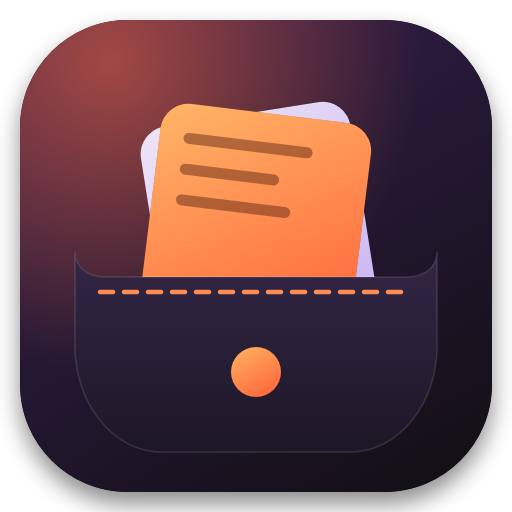

<p align="center"></p>

# Pocket

A fast, good-looking clipboard manager that lives in your Mac's menu bar. Everything you copy lands in your pocket — searchable, pinnable, and one keystroke away.

Native Swift + SwiftUI. No Electron, no dependencies, no network access. History stays on your Mac.

## Features

- **Instant access** — press **⌃⌘V** anywhere, or click the menu bar icon.
- **Smart clips** — colors get a swatch (with RGB), links show their host, code gets a monospaced block, images get a thumbnail.
- **Search + filters** — filter by Text, Links, Colors, Code, Images or Pinned.
- **Keyboard first** — `↑↓` move, `⏎` copy, `⌘1–9` quick copy, `⌘⌫` delete, `Esc` closes.
- **Transform in one click** — UPPERCASE, Title Case, slugify, sort/dedupe lines, prettify/minify JSON, Base64 and URL encode/decode.
- **Pin** the clips you reuse; pinned clips never get evicted.
- **Private by design** — skips clips marked concealed/transient (password managers), stores history locally in `~/Library/Application Support/Pocket`.
- 7-day activity sparkline, launch at login, right-click the menu bar icon for options.

## Install

Download `Pocket-x.y.z.dmg` from Releases, open it, and drag Pocket to Applications.

The app is ad-hoc signed (not notarized), so on first launch **right-click Pocket → Open**, or run:

```sh
xattr -dr com.apple.quarantine /Applications/Pocket.app
```

Requires macOS 14 or later.

## Build from source

Only the Xcode Command Line Tools are needed.

```sh
swift test                 # run unit tests
swift run Pocket           # run in debug
./scripts/build.sh         # -> build/Pocket.app (universal, signed ad-hoc)
./scripts/make_dmg.sh      # -> dist/Pocket-1.0.0.dmg
```

Set `POCKET_SHOW_ON_LAUNCH=1` to open the panel on launch (handy for screenshots).

## Layout

```
Sources/PocketCore   classification, transforms, history logic (unit tested)
Sources/Pocket       SwiftUI app: menu bar item, floating panel, pasteboard store
scripts/             icon generator, app bundler, DMG packager
```

> Note: with only the Command Line Tools installed, SwiftUI's `@State` macro plugin is unavailable, so the app uses a tiny `@Local` wrapper (`Sources/Pocket/Local.swift`) that forwards to `State`.

## License

MIT
